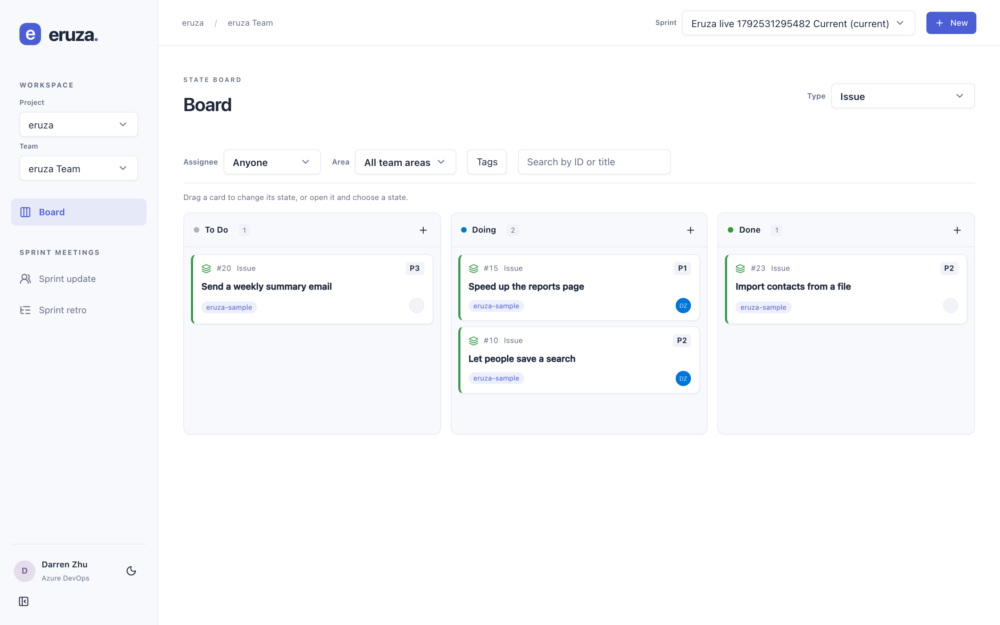
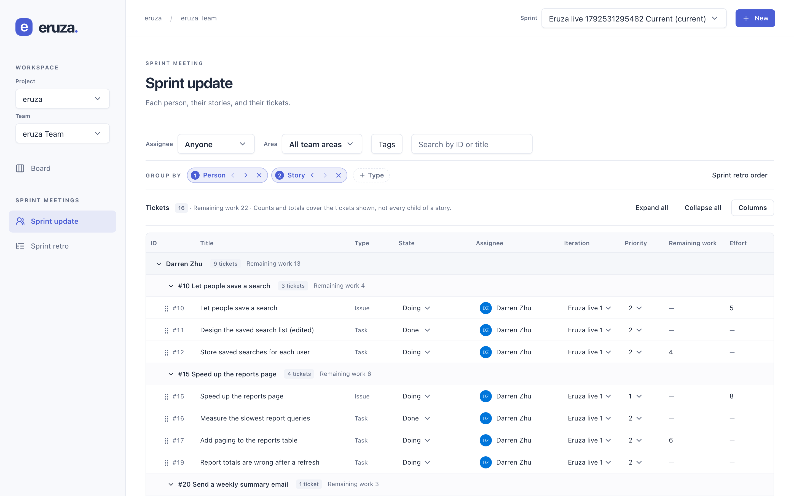

# Eruza

**Eruza: Azure DevOps Boards, reimagined.**

Eruza is a web app that runs on your own computer. It gives you a faster way to work
with Azure DevOps Boards: a board, a grid for sprint meetings, and a work item editor.
Your work items stay in Azure DevOps. Eruza does not keep its own copy.





## Features

- **Board.** Pick a work item type, and its states become the columns. Drag a card to
  change its state, or use a column's **+** button to create an item in that state.
- **Sprint picker.** Each view opens on the team's current sprint. You can also pick an
  earlier sprint.
- **Sprint meeting grid.** Lists every work item in the sprint, of any type. The grid
  calls each one a ticket.
  - _Sprint update_ groups by Person > Story > Ticket.
  - _Sprint retro_ groups by Story > Person > Ticket.
  - A **Group by** bar lets you add, remove, or reorder the group levels: Person, Story,
    and Type.
  - Each group shows its ticket count and remaining work. Columns can be sorted and
    resized.
  - Edit cells in place. When the grid is grouped by Story, drag a ticket onto a story to
    make that story its parent.
  - Stays fast with more than 1,000 tickets in mock-mode tests.
- **Work item editor.** Open an item in a side panel or a full page. Edit fields and the
  description, change the parent, and add comments with `@` mentions.
- **Quick actions.** Press `C` to create an item, or `Cmd/Ctrl+K` to open the command
  palette. Press `I` to assign the open item to yourself. Copy an item's ID or link, open
  it in Azure DevOps (not in mock mode), or move it to the Azure DevOps Recycle Bin after
  you confirm.
- **Filters** for assignee, area, tags, and ID or title. They stay set when you switch
  views.
- **Mock mode** with made-up data, so you can try Eruza without an Azure DevOps account.

## How it works

- Eruza runs only on your computer, for one person. Nothing is hosted online, and there
  is no database or sign-in page.
- The browser talks only to a small local server. That server calls Azure DevOps with
  your Azure CLI sign-in, so your token never reaches the browser.
- You can switch between projects and teams in one organization.

## Get started

Install Node.js `24.22.1` (see `.node-version`). Then run:

```sh
npm ci
npm run dev
```

Open <http://127.0.0.1:5173>. Without a `.env` file, Eruza starts in mock mode with
made-up data. Mock changes are kept in memory and reset when you restart. Press Ctrl+C to
stop.

### Connect to Azure DevOps

1. Install the Azure CLI and sign in:

   ```sh
   az login --allow-no-subscriptions
   ```

   To sign in to a specific tenant, add `--tenant <domain>`.

2. Check that you can get a token for Azure DevOps. The long ID is the fixed Azure DevOps
   resource ID. The command prints only the token's expiry time, not the token:

   ```sh
   az account get-access-token --resource 499b84ac-1321-427f-aa17-267ca6975798 --query expiresOn --output tsv
   ```

3. Copy `.env.example` to `.env` and set:
   - `MOCK=0` to turn off mock mode.
   - `ADO_ORG` to your organization name, not a URL. For
     `https://dev.azure.com/contoso`, use `contoso`.
   - `ADO_DEFAULT_PROJECT` (optional) to the exact name of the project to open first.
   - `PORT` (optional) for the local API server. The default is `3001`. You still open the
     app at port `5173`.

4. Run `npm run dev` and open <http://127.0.0.1:5173>.

If a setting is wrong, `npm run dev` stops with "Check MOCK, PORT, and ADO_ORG in local
settings." `MOCK` must be `0` or `1`, and `PORT` must be between 1024 and 65535. When
`MOCK=0`, `ADO_ORG` must be set and use only letters, numbers, and `-`.

`.env` holds settings only. Never put tokens or passwords in it. Keep the Azure CLI
installed, because Eruza uses it to get tokens. Eruza can only do what your Azure DevOps
account is allowed to do.

### Add sample items (optional)

To try Eruza on a test project, set that project as `ADO_DEFAULT_PROJECT`, set `MOCK=0`,
and run:

```sh
npm run seed
```

- It shows the project, team, and sprint, then waits for you to type `yes`. To skip the
  question, run `npm run seed -- --yes`. In a script or CI job, where it cannot ask,
  `--yes` is required.
- It creates 17 made-up items in the default team's current sprint: 5 stories with 12
  child tasks. The story type comes from your process, such as User Story or Issue. If
  the team has a future sprint, one story goes there.
- Two of the tasks are created as bugs. They are created as tasks instead if your process
  has no Bug type, your team tracks bugs with stories, or a bug needs a field the script
  cannot fill.
- It stops before creating anything if a story or task needs a field it cannot fill.
- Every sample has the `eruza-sample` tag. Some are assigned to you; the rest are
  unassigned, so nobody else gets a notice.
- `npm run seed -- --remove` moves the samples to the Recycle Bin. It only removes items
  that still have the tag. The sample IDs and organization are saved in
  `tmp/sample-ids.json`, which Git ignores. Keep the same `ADO_ORG` until you remove them.
- Running `npm run seed` again stops until the earlier samples are removed.

### Custom name and logo (optional)

Add one or both of these to `.env`:

```dotenv
VITE_BRAND_NAME="Sample workspace"
VITE_BRAND_LOGO=/branding/logo.svg
```

- Put the logo directly in `public/branding/`. In `.env`, leave out `public/`, as shown
  above. A logo in a subfolder or at a web address is ignored, and Eruza's own logo is
  shown.
- Use a square SVG, PNG, WebP, JPEG, GIF, or ICO file. The file name may use only
  letters, numbers, `-`, and `_`.
- Restart `npm run dev` after a change.
- The name appears in the sidebar and the browser tab. The logo replaces the Eruza logo in
  the sidebar and the favicon. If the logo fails to load, Eruza's own logo is shown.
- These values are built into the browser page, so use display text only. Never put
  secrets in `VITE_` settings.

Git ignores both `.env` and `public/branding/`.

## Limitations

- Works only with Azure DevOps Services at `dev.azure.com`, not Azure DevOps Server.
- A sprint view loads up to 5,000 items. A larger result is marked as incomplete.
- Board columns are work item states. Eruza does not copy your Azure DevOps board
  columns, swimlanes, or card order.
- Only the Description field is shown as rich text. Other HTML fields, such as a bug's
  repro steps, are not shown. A required custom HTML field appears as a plain text box
  with raw HTML.
- A description with colors, fonts, highlights, or mentions is read-only in Eruza. Edit
  it in Azure DevOps.
- You cannot upload attachments.
- Tags are edited as text, separated by `;`.
- You can add comments, but not edit or delete them. `@` mention suggestions come from
  the selected team.
- Browser tests run in Chromium on macOS. Other browsers, browsers on Windows, and screen
  readers have not been tested. Phone and tablet layouts were checked with Chromium's
  device emulation, not on real devices.

## Status

Stage 1, a personal app on your own computer, is complete. Besides the automated tests,
it was checked against a real Azure DevOps test project: sign-in, sprints, creating and
editing items, parent and state changes, comments, mentions, and moving items to the
Recycle Bin. Custom grouping and the custom name and logo came later and were tested
with mock data only.

For test results and next steps, see [docs/handoff.md](docs/handoff.md) and
[docs/milestones.md](docs/milestones.md).

## Development

| Command            | What it does                                          |
| ------------------ | ----------------------------------------------------- |
| `npm run dev`      | Start the app and the local server                    |
| `npm run check`    | Lint, format check, type check, unit tests, and build |
| `npm run test:e2e` | Browser tests in mock mode                            |
| `npm run format`   | Format all files with Prettier                        |

Before you run the browser tests for the first time, run
`npx playwright install chromium`. Stop `npm run dev` before you run them, because they
start their own server on the same ports.

Built with React, TypeScript, Vite, TanStack (Query, Router, Table, Virtual), Tailwind
CSS, shadcn/ui with Radix, dnd-kit, TipTap, cmdk, DOMPurify, Hono, Zod, and
`@azure/identity`. Tests use Vitest and Playwright. All versions are pinned in
`package-lock.json`.

## Project docs

| File                                         | What it covers                                    |
| -------------------------------------------- | ------------------------------------------------- |
| [AGENTS.md](AGENTS.md)                       | Rules for contributors (`CLAUDE.md` links to it)  |
| [docs/requirements.md](docs/requirements.md) | What Stage 1 does and does not do                 |
| [docs/architecture.md](docs/architecture.md) | Folder layout and data flow                       |
| [docs/api.md](docs/api.md)                   | The local server's API and its Azure DevOps calls |
| [docs/milestones.md](docs/milestones.md)     | Milestones and acceptance checks                  |
| [docs/handoff.md](docs/handoff.md)           | Current checkpoint, test evidence, and next steps |
| [docs/privacy.md](docs/privacy.md)           | What must never be committed                      |

## Privacy

This repository is public. Never commit tokens, real organization or project names, real
work items, or personal details. Read [docs/privacy.md](docs/privacy.md) before you
contribute. The screenshots above come from the owner's test project. They show sample
items from `npm run seed` and the owner's name, which the owner approved.

## Trademarks

Eruza is not affiliated with or endorsed by Microsoft. Microsoft, Azure, and Azure DevOps
are trademarks of the Microsoft group of companies.

## License

[MIT](LICENSE).
